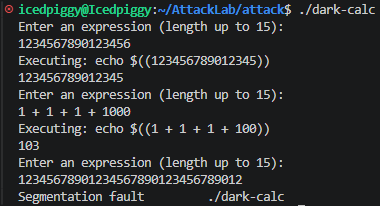
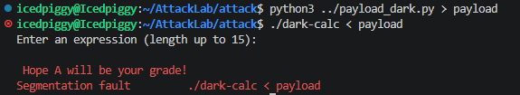

# AttackLab 实验报告

林诗航 24300240228

### 1. 观察栈帧 `input` (20 pts 报告)


1. `input` 的直接调用者是 `main`，返回地址是 `0x401ad1`。
2. 
- `push rbp`：把调用者 `main` 的旧 `rbp` 压栈保存，`rsp -= 8`
- `mov rbp, rsp`：建立 `input` 的栈帧，此时 `rbp` 指向刚保存的旧 `rbp`
- `sub rsp, 0x10`：给 `input` 的局部变量分配 16 字节栈空间
- `$rbp : 0x0000721000800fe0  →  0x0000721000800ff0`；这个 `0x0000721000800ff0` 来自 `push rbp` 保存下来的 `main` 的 `rbp`
3. `$rbp : 0x0000721000800fe8  →  0x0000000000401ad1  →  <main+000e> mov eax, 0x0`；`0x0000000000401ad1` 是一个返回地址，即 `main` 中调用完 `input` 后要返回执行的下一条指令地址
4. `0x401acc <main+9>: call 0x401977 <input>`
5. 
- `call` 作用：将返回地址压栈；跳转到指定地址。
- prologue `push rbp; mov rbp,rsp; sub rsp,0x10` 作用：保存调用者的 `rbp`；建立当前函数的栈帧；为局部变量分配空间。
- `leave` 作用：等价于 `mov rsp,rbp; pop rbp`；丢弃局部变量空间；恢复调用者的 `rbp`；让 `RSP` 指向返回地址。
- `ret` 作用：从栈顶弹出返回地址到 `RIP`；`RSP += 8`；跳回调用者继续执行。

### 2. 用不同长度的字符串输入测试 `dark-calc` (5 pts 报告)



1.
- 20 个字符: 被截断，只处理前 15 个字符；
- 32 个字符：段错误；


2.
- 根据汇编代码发现 `0x401ad1` 为 `input` 返回时跳转的地址，进一步调试进入 `input`，从第一张截图发现返回地址被存在栈空间的地址 `0x0000721000800fe8`；
- 临时字符数组 `expression` 接受输入的字符串，地址为 `0x0000721000800fd0`；
- 数据从 `0x0000721000800fd0` 不断向地址高位延伸，如第二张截图所示，最后超量的数据将 `0x0000721000800fe0` 的内容和 `0x0000721000800fe8` 存的地址完全覆盖

### 3. 利用缓冲区漏洞执行 `./malware` (25 pts 测试 + 5 pts 报告)

- 根据 2 的截图 `command_buf` 的地址为 `0x6030d0`；在 `gets(expression)` 后，直接从 `expression` 复制过来，`input()` 返回；在 `eval()` 函数原地将表达式包装成指令在 `system` 运行；
- 仅当 `dark-calc` 执行 `./malware` 时才成功，需要让 `system` 函数运行 `./malware`，那么需要：
    - 将输入的前缀改为 `./malware`，剩余 7 字符可直接用 `\0`
    - 将 `0x0000721000800fe0` 的内容照抄，否则会段错误；
    - 将 ret 跳转的地址改为 `system` 的地址之前的 `401a6b: mov $0x6030d0,%edi`，保证参数为 `command_buf`，然后立即运行 `system`，从而绕过 `echo $(())` 的包装；

那么构造如下：
```python
payload = b"./malware" + b"\x00" * 7 + b"\xf0\x0f\x80\x00\x10\x72\x00\x00" + b"\x6b\x1a\x40\x00\x00\x00\x00\x00"
```

结果如下：


### 4. 用 GDB 检查 main 函数的机器码 (5 pts 报告)

1. 
- `main` 函数的前三行汇编为 `push rbp; mov rbp,rsp; mov eax,0x0`；
- 执行 `x /9xb 0x401ac3` 结果整理为 `55 48 89 e5 b8 00 00 00 00`；
- 对应的机器码： `push rbp` 为 `55`，`mov rbp,rsp` 为 `48 89 e5`，`mov eax,0x0` 为 `b8 00 00 00 00`；

2. 排列方式：
```
[0x401ac3, 0x401ac4) : push rbp
[0x401ac4, 0x401ac7) : mov  rbp,rsp
[0x401ac7, 0x401acc) : mov  eax,0x0
```

### 5. 栈空间执行 (25 pts 测试 + 5 pts 报告)

- 类似 3(Task1)，对 `0x0000721000800fe8` 改为 `expression` 的地址；不能改为 `command_buf` 是因为 `strcpy` 的时候会忽略第一个 `0x00` 及之后的部分；不能直接跳到 `grade_eval`，而是要先 `mov edi, 4`
- `command_buf` 或 `expression` 都有 16B 的余量，够用来 `mov edi, 4; mov ebx, 0x401a87; call rbx; ret`
- 将 `0x0000721000800fe0` 的内容照抄，否则会段错误；

那么构造如下：
```python
payload = b"\xbf\x04\x00\x00\x00" + b"\xbb\x87\x1a\x40\x00" + b"\xff\xd3" + b"\xc3" + b"\x00" * 3 + b"\xf0\x0f\x80\x00\x10\x72\x00\x00" + b"\xd0\x0f\x80\x00\x10\x72\x00\x00"
```

结果如下：


能正确输出 `Hope A will be your grade! `，但是段错误，不完美，但是我自己只能做到这个程度了。

### 6. ROP (10 pts 测试 + 10 pts 报告)


### 7. Canary (10 pts 测试 + 10 pts 报告)


### 使用的工具

- Deepseek-V4.1-Flash-1017: 对于问题 1 帮我确定答案的出处；对于问题 4 仅查询 call 语法相关